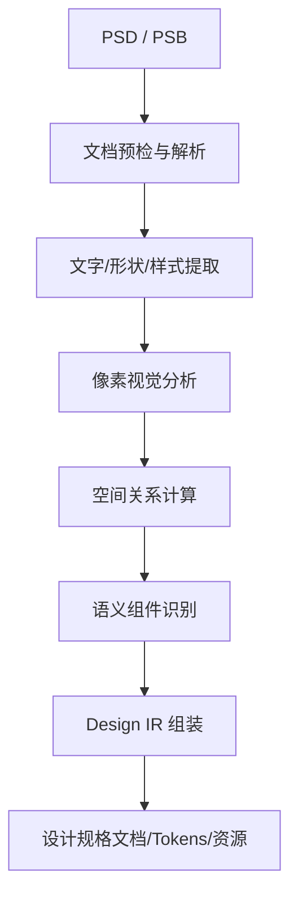

# PSD Design Inspector Skill

将 Photoshop PSD/PSB 文件转换为完整、可溯源的设计信息（Design IR），供前端还原、设计自动化系统使用。

## 特性

- ✅ **原生解析**: 提取图层树、类型、可见性、位置、尺寸、不透明度、混合模式等原生属性
- ✅ **文字样式**: 解析 characterRuns（字体、字号、颜色、字距）与 paragraphRuns（对齐、行高、缩进）
- ✅ **样式与效果**: 提取矢量填充/描边、圆角，以及投影、内阴影、发光、颜色/渐变/图案叠加
- ✅ **几何分析**: 计算相对坐标、间距、对齐关系、布局候选，全部标注为测量值
- ✅ **Token 提取**: 生成颜色、字体、间距、边框、阴影等 Token 候选，需人工复核
- ✅ **可视化**: 生成原图/标注预览图和独立 HTML 检查器
- ✅ **资源导出**: 按图层导出 PNG（透明通道、偏移、尺寸、哈希、内容去重）
- ✅ **报告与校验**: 每次运行生成 extraction-summary，`--report` 生成详细报告；Design IR 通过 JSON Schema 校验
- ✅ **可追溯**: 每个属性记录来源(source) 和置信度(confidence)
- 🚧 **语义组件**: 独立识别 Button、Input、Card 等组件（P3，尚未实现）

## 快速开始

### 安装

```bash
pip install -e .
```

### 基本用法

```bash
# 全量分析（几何 + Token + 预览 + HTML 检查器 + 资源 + 详细报告）
psd-inspector inspect \
  --input ./design/home.psd \
  --output ./output/home \
  --profile full \
  --export-assets \
  --report

# 快速结构检查（仅原生图层与 document 元数据）
psd-inspector inspect \
  --input ./design/home.psd \
  --output ./output/home-fast \
  --profile fast

# 查看特定图层详情
psd-inspector layer get \
  --ir ./output/home/design.json \
  --id layer-1038

# 查询某图层的相邻元素与间距（实测几何）
psd-inspector geometry neighbors \
  --ir ./output/home/design.json \
  --id layer-1038 \
  --distance 100

# 从 IR 重新提取 Token
psd-inspector tokens extract \
  --ir ./output/home/design.json \
  --types colors,spacing \
  --output ./output/home/retoken.json

# 重新生成标注图（默认复用 previews/original.png）
psd-inspector annotate \
  --ir ./output/home/design.json \
  --show bounds,ids,spacing \
  --output ./output/home/annotated.png
```

## 输出结构（当前）

```
output/
├── design.json           # 主数据：Design IR（原生层 + 分析结果 + Token）
├── source-layers.json    # 原始图层树的投影
├── geometry.json         # 测量关系、对齐、间距、布局候选
├── design-tokens.json    # Token 候选
├── assets/               # --export-assets
│   ├── layer-previews/   # 图层 PNG（透明、原始尺寸）
│   └── asset-index.json  # 图层 ID、坐标、尺寸、mask、哈希、去重关系
├── previews/
│   ├── original.png      # psd-tools 合成预览
│   └── annotated.png     # 边界 + 图层 ID + 实测间距
├── viewer.html           # 独立 HTML 检查器（图片与数据均内嵌）
├── reports/
│   ├── extraction-summary.json  # 每次运行都会生成
│   ├── unsupported.md           # --report
│   ├── layer-inventory.md       # --report
│   ├── design-spec.md           # --report
│   └── validation.json          # --report
└── manifest.json         # 运行元数据、文件清单与哈希、警告、校验状态
```

`fast` profile 只输出 `design.json`、`source-layers.json`、`reports/extraction-summary.json` 和 `manifest.json`；同时显式传入 `--export-assets`/`--report` 时才额外生成对应目录。

语义组件树 `components.json` 仍在路线图中（P3）。

## 可视化检查器

`viewer.html` 可直接在浏览器打开，无需本地服务器：

- 图层边界按类型着色，悬停显示名称/尺寸/坐标
- 点击图层查看 IR 记录、提取状态与属性来源
- 支持搜索名称/ID、显示隐藏图层
- 可切换图层边界、名称、间距线、布局候选框
- 诊断警告直接展示在侧栏

## 工作流



## 配置文件

支持三种提取级别:

| Profile | 特点 | 场景 |
|---|---|---|
| `fast` | 仅原生属性，低计算量 | 快速结构检查 |
| `full` | 原生属性 + 几何/Token/预览/检查器 | **默认推荐** |
| `deep` | 在 full 基础上启用更多像素测量 | 复杂 UI（后续继续扩充） |

## 几何与 Token 说明

- 所有坐标为文档全局坐标下的 `sourceBounds`；`visibleBounds` 当前等于 `sourceBounds`，像素级可见边界属于 P3。
- 间距只对正交投影重叠比例 ≥ 0.3 的图层对计算；对角线关系不会生成 CSS gap。
- `layoutHypotheses` 是带 `evidence`、`confidence`、`basis: measured_geometry` 的候选，不是 PSD 原生值。
- Token 名称（如 `primary`、`textPrimary`）是候选命名，必须人工复核；颜色出现频率不代表品牌主色。
- `full`/`deep` 会从栅格图层采样主色，来源标记为 `pixel_measured`，属于统计结果。
- 文字字号以 PSD 的点值(`pt`)保存，并按文档 DPI 换算为 `effective_font_size_px`；换算依据写入 `source_font_size.conversion_basis`。
- `font.family` 由 PostScript 名称拆分得到（如 `PingFangSC-Regular` → `PingFangSC`），未检测系统字体缺失。
- 矢量形状的填充色来自 `vscg` 原生记录，描边色来自 `vstk`；图层效果即使处于禁用状态也会保留并标记 `enabled: false`。
- BevelEmboss、Satin 等无法在 IR 中表达的效果会记录到 `extraction.unsupported_properties`，不会伪造字段。

## 资源与报告说明

- `assets/layer-previews/` 中的 PNG 是 psd-tools 对单个图层的栅格渲染，不是原生矢量导出；不保证与 Photoshop 完全一致（尤其是未支持的效果）。当前不生成 WebP/SVG。
- 资源按 PNG 内容 SHA256 去重：相同内容的多个图层共用一个文件，`asset-index.json` 用 `duplicatedFrom` 记录来源图层。
- 导出的 PNG 不嵌入 ICC 配置：psd-tools 生成的 profile 带有运行时间戳，会导致相同输入产生不同哈希；色彩管理以原 PSD 为准。
- `asset-index.json` 记录原始图层 ID、文档坐标、宽高、可见性、mask 标记、哈希和导出路径；隐藏图层也会导出，可通过 `visible` 区分。
- `reports/extraction-summary.json` 每次运行都会生成；`--report` 额外生成 `unsupported.md`、`layer-inventory.md`、`design-spec.md`、`validation.json`。
- 校验失败不会中断解析：错误写入 `diagnostics.validationResults`、`reports/validation.json` 和 `manifest.validation`。

## Schema

主数据结构定义在 `schemas/design-ir.schema.json`，运行时通过 `jsonschema` 校验 `design.json`；更细粒度的字段定义由 `src/psd_inspector/models/` 下的 Pydantic 模型承担。

## 开发状态

### P1: 原生解析核心 ✓ (部分完成)

- [x] 数据模型定义
- [x] PSD 解析适配器
- [x] 基础 Pipeline
- [x] 图层树、可见性、不透明度、混合模式
- [x] 文字样式解析（characterRuns / paragraphRuns）
- [x] 填充和描边提取（矢量形状）
- [x] 图层效果提取（阴影 / 发光 / 叠加 / 描边效果）
- [ ] 像素级 visibleBounds / effectBounds
- [x] JSON Schema 运行时验证
- [x] 资源导出（PNG + 去重索引）与报告

### P2: 几何与设计系统 ✓

- [x] 相对坐标与父子关系
- [x] 对齐与间距测量
- [x] Flex / Grid / Absolute 布局候选（含证据与置信度）
- [x] 颜色（原生填充/文字/渐变/栅格采样）、字体、间距、边框、阴影 Token 候选
- [x] 标注预览图
- [x] 独立 HTML 检查器
- [ ] 重复卡片/组件的专门模式输出
- [ ] `componentPatterns` 填充

### P3: 视觉与语义补全

- [ ] OpenCV 集成
- [ ] 栅格化元素分析
- [ ] 组件识别

### P4: Photoshop 与 Agent 集成

- [ ] UXP 高级补全
- [ ] Batch 处理
- [ ] Cache 机制

## 原则

1. **原生优先**: 不使用 AI 猜测已有确定信息
2. **只读**: 默认不修改原始 PSD 文件
3. **透明**: 无法可靠判断时输出 `unknown/null`,不得伪造
4. **分离**: 原始图层树与语义组件树独立存储
5. **可追溯**: 每个属性记录 source 和 confidence

## 测试

运行测试套件:

```bash
pytest tests/ -v
```

PSD 测试夹具在测试运行时由 psd-tools 生成，仓库中不保存二进制文件。

## License

MIT License
